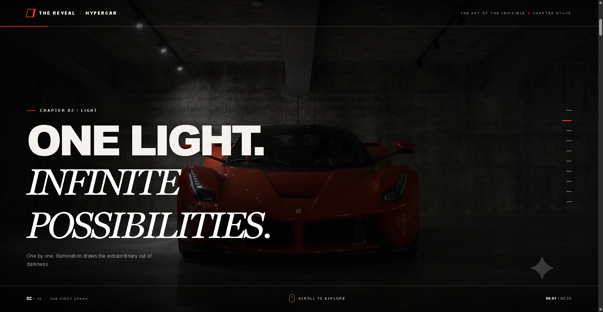
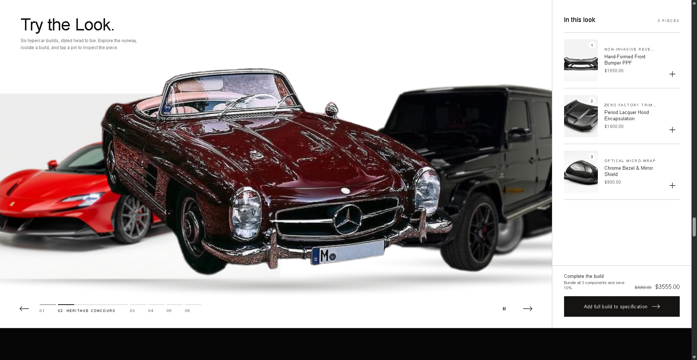
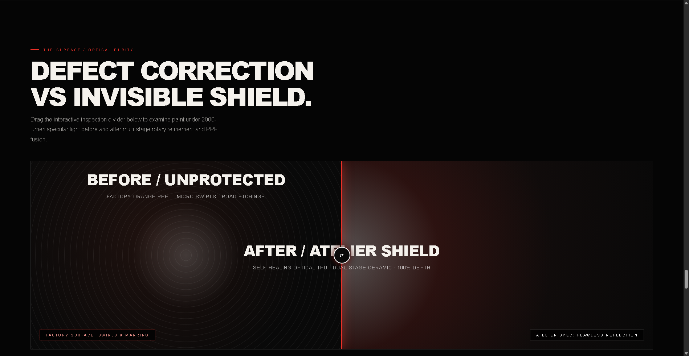

# 🏎️ THE REVEAL — Ferrari Hypercar Cinematic Experience & 3D Runway Atelier

<div align="center">


<p align="center">
  <b>A bespoke, high-performance web experience fusing a 20-second hardware-accelerated video-scrub hero with an interactive 3D circular runway carousel, real-time hotspot part inspection, and a reactive atelier configuration bag.</b>
</p>

[**🌐 Explore Live Deployment**](https://ferrari-runway.vercel.app) • [**Report Bug**](https://github.com/juzerjawadi-web/the-reveal-ferrari-runway/issues) • [**Request Feature**](https://github.com/juzerjawadi-web/the-reveal-ferrari-runway/issues)

</div>

---

## 📸 Visual Showcase & Screen Captures

### 1. Section 1: The 20-Second Seamless Cinematic Scroll Hero
*Ultra-smooth momentum scrolling powered by Lenis v1.1.18 and a 60fps video-scrubbing timeline. As the user navigates, the video position synchronizes with scroll delta via frame-accurate seeking with active audio telemetry and HUD controls.*

<div align="center">
  
</div>

---

### 2. Section 2: The 3D Bespoke Runway Carousel
*An interactive 6-build ring carousel engineered as a native custom element (`<runway-section>`). Features real-time spring physics (`F = -k·x - c·v`), depth blurs, custom Drag/View cursor tracking, circular carousel wrapping, and interactive product component cards.*

<div align="center">
  
</div>

---

### 3. Section 3: Surface Defect Inspection & Quality Atelier Protocol
*Macro-level defect detection, telemetry analytics, and aerodynamic testing protocols alongside the styling bag shortlist drawer and hotspot component pins.*

<div align="center">
  
</div>

---

## ⚡ Key Highlights & Capabilities

- 🎯 **Frame-Accurate Video Scrubbing**: 20-second 1080p cinematic video mapped dynamically across scroll depth using normalized viewport interpolation (`currentTime = progress × duration`).
- 🏎️ **Custom 3D Circular Runway Engine**: Native `<runway-section>` Web Component simulating a 3D cylindrical stage with trigonometric model projection, depth of field blur (`backdrop-filter`/CSS blur), and inertia dragging.
- 🧲 **Second-Order Spring Physics**: Custom spring-damper integration (`stiffness = 95`, `follow lag = 0.04s`) for natural carousel settling and magnetic snap navigation.
- 🔍 **Interactive Component Hotspot Pins**: View Look overlay with numbered floating product pins that dynamically map to vehicle coordinates and open detailed component specifications.
- 🛍️ **Atelier Configuration & Styling Bag**: Full bundle pricing engine with instant currency calculations, spec selection, and modal dialog persistence.
- 🌊 **Momentum Scrolling Architecture**: Lenis smooth scroll engine initialized with custom lerp physics (`lerp: 0.08`, `wheelMultiplier: 1.1`, `smoothTouch: true`).
- 🚀 **Zero-Dependency Architecture**: Built entirely with Vanilla JavaScript (ES2024), standard Web APIs, and native CSS. No heavyweight JS frameworks.

---

## 🛠️ Backend Architecture & Video Streaming Pipeline

The project incorporates a specialized Node.js HTTP backend (`server.mjs`) crafted specifically for low-latency, high-throughput media streaming and video scrub workloads.

```
                           [Client Web Browser]
                                    │
                                    │ 1. HTTP GET / Range: bytes=1048576-2097151
                                    ▼
                ┌───────────────────────────────────────┐
                │       Node.js Streaming Server        │
                │             (server.mjs)              │
                └───────────────────┬───────────────────┘
                                    │
               2. Security & Path Sanitization (Traversals Blocked)
               3. Stat & Byte-Range Offset Calculation
               4. Chunked ReadStream Creation
                                    │
                                    ▼
               ┌────────────────────────────────────────┐
               │    HTTP 206 Partial Content Response    │
               │   Content-Range: bytes 1M-2M/17.5M     │
               │   Accept-Ranges: bytes                 │
               │   Content-Type: video/mp4              │
               └────────────────────┬───────────────────┘
                                    │
                                    ▼
                       [Client Hardware Decoder]
```

### 1. RFC 7233 Partial Content Range Protocol
Standard static HTTP servers serve video files monolithically (HTTP 200 OK), forcing browsers to buffer large multi-megabyte streams before scrubbing is allowed. `server.mjs` implements **RFC 7233 byte-range negotiation**:
- Reads incoming `Range: bytes=start-end` request headers.
- Computes byte bounds against file disk size (`statSync.size`).
- Emits **`HTTP 206 Partial Content`** with exact range bounds:
  ```http
  HTTP/1.1 206 Partial Content
  Content-Type: video/mp4
  Accept-Ranges: bytes
  Content-Range: bytes 2097152-4194303/17569546
  Content-Length: 2097152
  ```
- This allows browsers to seek instantly to any timestamp in the 20-second video without buffering previous frames, providing seamless 60fps scrubbing during high-speed wheel scrolling.

### 2. High-Performance Stream Piping (`fs.createReadStream`)
Instead of loading video files into V8 heap memory (which causes GC stutter during scrubbing), the backend spawns lightweight OS-level file descriptors using Node.js readable streams:
```javascript
createReadStream(filepath, { start, end }).pipe(res);
```
Chunks are streamed directly to the socket with zero intermediate heap buffering, maintaining constant minimal memory usage under concurrent load.

### 3. Path Traversal & MIME Guardrails
All file requests pass through strict normalization checks preventing directory traversal attacks (`filepath.startsWith(BASE + sep)`), serving verified MIME types for HTML, CSS, JS, SVG, WebP, JPEG, PNG, and MP4.

### 4. Edge Deployment Architecture (Vercel Anycast CDN)
When deployed to Vercel:
- Static video chunks and assets are distributed across Vercel’s global Edge Network.
- Native HTTP 206 Range Streaming is fulfilled at the edge point of presence (PoP) nearest to the user.
- Cache-Control headers configured via `vercel.json` enforce immutable asset caching:
  ```json
  {
    "cleanUrls": true,
    "headers": [
      {
        "source": "/assets/(.*)",
        "headers": [
          { "key": "Cache-Control", "value": "public, max-age=31536000, immutable" }
        ]
      }
    ]
  }
  ```

---

## 📂 Repository Directory Layout

```text
├── assets/
│   ├── hero-scroll-720p.mp4          # Optimized 720p 60fps scrub video
│   ├── lenis.min.js                  # Studio Freight Lenis smooth scrolling library
│   ├── runway.css                    # 3D circular ring runway carousel styles
│   ├── runway.js                     # Custom element <runway-section> implementation
│   ├── screenshot-1-hero.png         # Section 1 high-resolution screen capture
│   ├── screenshot-2-runway.png       # Section 2 high-resolution screen capture
│   ├── screenshot-3-atelier.png      # Section 3 high-resolution screen capture
│   ├── car-*.png / car-*.jpg         # High-resolution hypercar studio cutouts
│   └── part-*.jpg                    # Bespoke carbon fiber & titanium component parts
├── .gitignore                        # Git exclusion configuration
├── AGENTS.md                         # Coding & architecture guidelines
├── Ferrari_20s_Seamless_Cinematic... # 1080p master cinematic video asset
├── index.html                        # Main multi-section production application
├── package.json                      # Project manifest & npm scripts
├── server.mjs                        # Node.js RFC 7233 range-request streaming server
├── vercel.json                       # Vercel Edge configuration & caching rules
└── README.md                         # Project documentation, architecture & screenshots
```

---

## 💻 Tech Stack & Dependencies

| Layer | Technology | Details |
|---|---|---|
| **Frontend Framework** | Vanilla HTML5 & ES2024 JS | Custom Element `<runway-section>`, zero framework overhead |
| **Styling & Physics** | CSS3 & Custom Math | 3D Perspective Rings, Spring-damper physics, Backdrop filters |
| **Smooth Scrolling** | Lenis v1.1.18 | Decoupled virtual scroll interpolation with normalized delta |
| **Media Delivery** | HTTP 206 Byte Ranges | RFC 7233 partial content chunked audio/video streaming |
| **Backend Runtime** | Node.js (v18 / v20 / v22+) | Native `node:http`, `node:fs`, `node:path` stream pipelines |
| **Cloud Hosting** | Vercel Edge Network | Anycast edge caching with HTTP/2 and HTTP/3 multiplexing |

---

## 🚀 Quickstart & Local Installation

### Prerequisites
- Node.js 18.0.0 or higher
- Modern web browser (Chrome, Edge, Safari, Firefox) with WebGL & Video acceleration enabled

### Steps

1. **Clone the repository:**
   ```bash
   git clone https://github.com/juzerjawadi-web/the-reveal-ferrari-runway.git
   cd the-reveal-ferrari-runway
   ```

2. **Start the local streaming server:**
   ```bash
   npm run dev
   ```

3. **Open the application:**
   Navigate to [http://localhost:4173](http://localhost:4173) in your browser.

---

## 🌐 Deployment

### Deploying to Vercel
Deploy seamlessly using the Vercel CLI:
```bash
npx vercel --prod
```

### Deploying with Git
Connect the repository to your Vercel Dashboard for automated continuous deployment on push to `main`.

---

## 👤 Author & Maintainer

- **GitHub**: [@juzerjawadi-web](https://github.com/juzerjawadi-web)
- **Email**: [HUSAIN.RAJODI@GMAIL.COM](mailto:HUSAIN.RAJODI@GMAIL.COM)
- **Vercel Account**: [HUSAINRAJ](https://vercel.com/husainraj)

---

## 📄 License

This project is licensed under the **MIT License**.
